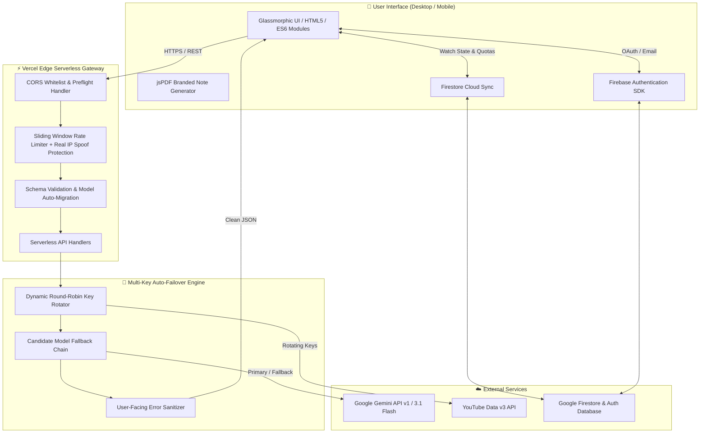

<div align="center">

  

  # 🎓 Aidube
  ### *Democratizing Education Through Structured AI-Powered Learning*

  [](https://aidube.com)
  [](https://aidube.com)
  [](#-automated-testing)
  [](https://ai.google.dev/)
  [](https://firebase.google.com/)
  [](LICENSE)

  <p align="center">
    <b>Transforming free, scattered web tutorials into structured, distraction-free classrooms with real-time AI study companions.</b>
  </p>

  [Explore Live App](https://aidube.com) • [Report Bug](https://github.com/ainaanraza/Aidube/issues) • [Request Feature](https://github.com/ainaanraza/Aidube/issues)

</div>

---

## 📌 Table of Contents

- [💡 Why Aidube Exists](#-why-aidube-exists)
- [✨ Core Features](#-core-features)
  - [1. Distraction-Free Classroom](#1-distraction-free-classroom)
  - [2. Instant Notes & PDF Generation](#2-instant-notes--pdf-generation)
  - [3. Executive AI Summaries](#3-executive-ai-summaries)
  - [4. Interactive Knowledge Checks](#4-interactive-knowledge-checks)
  - [5. Autonomous Learning Roadmaps](#5-autonomous-learning-roadmaps)
  - [6. Deep Research Assistant](#6-deep-research-assistant)
- [🏛️ System Architecture](#️-system-architecture)
- [⚡ Enterprise Multi-Key Fallback Engine](#-enterprise-multi-key-fallback-engine)
- [🛡️ Security & Edge Controls](#️-security--edge-controls)
- [💻 Technology Stack](#-technology-stack)
- [🚀 Quick Start & Local Setup](#-quick-start--local-setup)
- [🧪 Automated Testing](#-automated-testing)
- [⚙️ Environment Variables](#️-environment-variables)
- [📂 Project Structure](#-project-structure)
- [📋 GitHub Repository About Configuration](#-github-repository-about-configuration)
- [📄 License & Author](#-license--author)

---

## 💡 Why Aidube Exists

> *"Knowledge today is mostly free — tutorials, full university lectures, and crash courses exist openly on the web. However, 90% of self-learners abandon courses due to algorithmic distractions, fragmented order, and a lack of self-assessment."*

Many traditional EdTech platforms charge high monthly subscriptions not for the knowledge itself, but simply to package it into an organized playlist with notes.

**Aidube bridges this gap without paywalls:**
1. **Curates & Structures:** Organizes top educational video series into clear, goal-oriented paths.
2. **Eliminates Algorithmic Noise:** Strips away comment wars, clickbait recommendations, and rabbit holes.
3. **Active Cognitive Retention:** Converts passive watching into active retention with AI-generated synthesis, downloadable styled study PDFs, and adaptive quizzes.

---

## ✨ Core Features

| Feature | Description | Output / Benefit |
| :--- | :--- | :--- |
| **🎓 Focus Classroom** | Cinema player mode with custom playlist navigation and automatic resume | Distraction-free interface with instant timestamp memory |
| **📝 Auto-Generated Notes** | Transcribes and structures key concepts, code snippets, and definitions | Markdown viewer + one-click styled PDF download (`jsPDF`) |
| **⚡ Smart Summaries** | Synthesizes hours of lectures into concise, high-yield takeaways | Read in 2 minutes before exams or revision sessions |
| **🎯 Interactive Tests** | Generates dynamic multiple-choice assessments with immediate answer rationale | Tracks scores, provides feedback, and flags weak areas |
| **🗺️ Learning Roadmaps** | Creates customized step-by-step career & topic roadmaps with milestones | Guided progression from Beginner $\rightarrow$ Advanced |
| **🔬 Deep Research Engine** | Synthesizes academic topics, real-world case studies, and terminology | Clear explanations with key takeaways |
| **☁️ Cross-Device Cloud Sync** | Seamlessly synchronizes course history, watch progress, and study quotas | Pick up where you left off on desktop, tablet, or mobile |

### 1. Distraction-Free Classroom
* **Zero Algorithmic Distraction:** Pure learning mode without related video rabbit holes or sidebar ads.
* **Smart Progress Tracking:** Cloud-persisted timestamps update in real-time so learners resume on any device.
* **Instant Keyboard Navigation:** Play, pause, skip, and toggle focus mode with intuitive keyboard controls.

### 2. Instant Notes & PDF Generation
* **Zero Delay Feedback:** Clicking "Generate Notes" triggers instant visual confirmation (0ms) and double-click protection.
* **Rich Markdown Formatting:** Automatically formats definitions, key takeaways, formulas, and code blocks.
* **Styled PDF Compilation:** Built-in PDF compiler creates branded, printable study notes directly in the browser.

### 3. Executive AI Summaries
* **High-Yield Compression:** Extracts core theses, practical applications, and bulleted takeaways from long educational lectures.
* **Independent Quota Management:** Separate quotas for summaries and notes ensure uninterrupted study sessions.

### 4. Interactive Knowledge Checks
* **Auto-Generated MCQs:** Custom test questions extracted from video topics to test conceptual understanding.
* **Instant Rationales:** Reveals why an answer is right or wrong immediately upon submission.

### 5. Autonomous Learning Roadmaps
* **Milestone Progression:** Generates structured multi-phase curricula with estimated completion times.
* **Integrated Resource Linking:** Curates the best corresponding tutorials for each milestone.

### 6. Deep Research Assistant
* **Topic Synthesis:** Deep-dives into complex topics, explaining core fundamentals, historical background, and real-world implementations.

---

## 🏛️ System Architecture

Aidube is built on a hybrid architecture combining a high-performance **Serverless Edge Gateway** with client-side reactive components:



---

## ⚡ Enterprise Multi-Key Fallback Engine

High availability is fundamental when serving AI-generated study content:

* **Automatic Key Rotation:** Supports comma-separated keys (`GEMINI_API_KEYS`, `YOUTUBE_API_KEYS`). If one key exhausts its quota (`429 RESOURCE_EXHAUSTED`), the backend seamlessly transitions to the next healthy key with zero user disruption.
* **Model Cascade Fallback:** Automatically cascades through modern, ultra-low-latency models:
  $$\text{gemini-3.1-flash-lite} \longrightarrow \text{gemini-3.5-flash} \longrightarrow \text{gemini-3.7-flash} \longrightarrow \text{gemini-2.5-flash}$$
* **Legacy Model Auto-Migration:** Incoming requests specifying outdated models (e.g. `gemini-1.5-pro` or `gemini-2.0-flash`) are upgraded server-side before execution, ensuring older mobile caches never receive 404 errors.
* **Sanitized User Errors:** All internal Google API and rate-limit details are filtered at the edge. Users receive clear, actionable messages without technical jargon or stack traces.

---

## 🛡️ Security & Edge Controls

Aidube implements defense-in-depth security practices across every layer:

* **Real IP Spoofing Prevention:** Prioritizes trusted edge headers (`x-real-ip`) over manipulable `x-forwarded-for` arrays.
* **Strict CORS Whitelisting:** Rejects unauthorized origin requests with instant `403 Forbidden` responses.
* **Strict Payload Enforcement:** Requests exceeding 64KB are rejected immediately to protect against Denial-of-Service (DoS).
* **Credential Isolation:** Client-side bundles contain zero API keys; all external provider requests are authenticated server-side.

---

## 💻 Technology Stack

<div align="center">

| Layer | Technologies |
| :--- | :--- |
| **Frontend** | HTML5, CSS3 (Custom Properties & Glassmorphism), Vanilla JavaScript (ES6 Modules), FontAwesome 6 |
| **Client Utilities** | `jsPDF` (Client-side PDF compiler), Marked.js (Markdown parsing) |
| **Auth & State** | Firebase Authentication (Google OAuth + Email/Password), Cloud Firestore |
| **Backend & Edge** | Vercel Serverless Functions (Node.js runtime), Python 3.9+ (Optional Flask local runner) |
| **AI & Media APIs** | Google Gemini Generative Language API (`gemini-3.1-flash-lite`), YouTube Data API v3 |
| **Testing** | Node.js Native Test Runner (`node --test`), Assert Module |

</div>

---

## 🚀 Quick Start & Local Setup

### Prerequisites
* **Node.js**: v18.0.0 or higher
* **Python**: v3.9+ (if running Python backend server locally)
* **Git**: Installed on your system

### 1. Clone the Repository
```bash
git clone https://github.com/ainaanraza/Aidube.git
cd Aidube
```

### 2. Configure Environment Variables
Copy `.env.example` into `.env`:
```bash
cp .env.example .env
```
Fill in your credentials (see [Environment Variables](#️-environment-variables) below).

### 3. Run Locally

#### Option A: Node.js / Vercel CLI (Recommended)
```bash
npx vercel dev
```
Open [http://localhost:3000](http://localhost:3000) in your browser.

#### Option B: Python Flask Local Server
```bash
pip install -r requirements.txt
python app.py
```
Open [http://localhost:5000](http://localhost:5000) in your browser.

---

## 🧪 Automated Testing

Aidube includes a native test suite covering security controls, input validation, origin protection, sliding-window rate limiting, and multi-key rotation fallback:

```bash
# Run all tests
npm test

# Or directly using Node.js
node --test test/*.test.mjs
```

### Test Suite Coverage
```text
✔ Security Controls: Input Validation & Sanitization (7 tests)
✔ Security Controls: CORS & Origin Protection (4 tests)
✔ Security Controls: Rate Limiting & Edge IP Spoofing Prevention (2 tests)
✔ Security Controls: Endpoint Handlers & Method Enforcement (9 tests)
✔ Multi-Key Rotation & Quota Fallback Test Suite (15 tests)
✔ Subtest Suites Passed: 6/6
✔ Total Tests Passed: 39/39 (100%)
```

---

## ⚙️ Environment Variables

Configure these variables in your `.env` file or in your **Vercel Project Settings**:

| Variable | Required | Description | Example |
| :--- | :---: | :--- | :--- |
| `GEMINI_API_KEYS` | **Yes** | Comma-separated Google Gemini API keys for automatic failover | `key1,key2,key3` |
| `GEMINI_API_KEY` | Optional | Single fallback Gemini API key | `AIzaSy...` |
| `YOUTUBE_API_KEYS` | **Yes** | Comma-separated YouTube Data v3 API keys | `keyA,keyB,keyC` |
| `YOUTUBE_API_KEY` | Optional | Single fallback YouTube API key | `AIzaSy...` |
| `ALLOWED_ORIGIN` | Optional | Custom allowed origin for strict CORS enforcement | `https://aidube.com` |
| `FIREBASE_CONFIG` | Optional | Client-side Firebase credentials (if overriding defaults) | JSON string |

---

## 📂 Project Structure

```text
Aidube/
├── api/                        # Serverless edge function handlers
│   ├── _lib/                   # Shared edge middleware
│   │   ├── cors.js             # CORS validation & preflight responses
│   │   ├── rateLimit.js        # Sliding-window rate limiter & IP protection
│   │   └── validation.js       # Payload bounds, schemas & model migrator
│   ├── gemini.js               # AI controller: rotation, fallback & sanitization
│   ├── index.py                # Legacy transcript and verification proxy
│   ├── research.js             # Deep research endpoint handler
│   └── youtube.js              # YouTube Data API controller & rotation
├── css/                        # Responsive stylesheet modules
│   ├── about.css               # Mission & about styling
│   ├── index.css               # Core design tokens & typography
│   ├── playlist.css            # Distraction-free classroom styling
│   └── ...
├── js/                         # Client-side ES6 modules
│   ├── firebase.js             # Firebase auth & Firestore sync service
│   ├── playlist.js             # Video player, notes & summary orchestrator
│   ├── research.js             # Deep research UI controller
│   ├── test.js                 # MCQ quiz engine
│   └── utils.js                # Shared helpers, toasts & error sanitizers
├── test/                       # Native automated test suite
│   ├── security.test.mjs       # CORS, DoS, schema & edge rate-limit tests
│   └── youtube-gemini-rotation.test.mjs  # Multi-key failover verification
├── index.html                  # Landing page & course explorer
├── playlist.html               # Distraction-free video classroom
├── research.html               # Deep topic research module
├── test.html                   # Interactive quiz module
├── roadmap.html                # Autonomous learning roadmap module
├── about.html                  # Mission, motive & philosophy
├── vercel.json                 # Security headers & cache-control rules
└── README.md                   # Project documentation
```

---

## 📋 GitHub Repository About Configuration

To give the repository a clean, professional appearance on GitHub, set the following under your repo's **About** settings:

* **Website**:
  ```text
  https://aidube.com
  ```
* **Description**:
  ```text
  Transform free internet video content into distraction-free, structured classrooms with AI-generated study notes, smart summaries, interactive tests, personalized roadmaps, and multi-key auto-failover engine.
  ```
* **Topics**:
  ```text
  education, edtech, ai-learning, gemini-api, study-assistant, distraction-free, youtube-learning, serverless, firebase, javascript
  ```

---

## 📄 License & Author

Distributed under the **MIT License**. See [`LICENSE`](LICENSE) for details.

Developed with ❤️ by **[Ainaan Raza](https://github.com/ainaanraza)**  
🌐 Explore the platform: **[aidube.com](https://aidube.com)**
